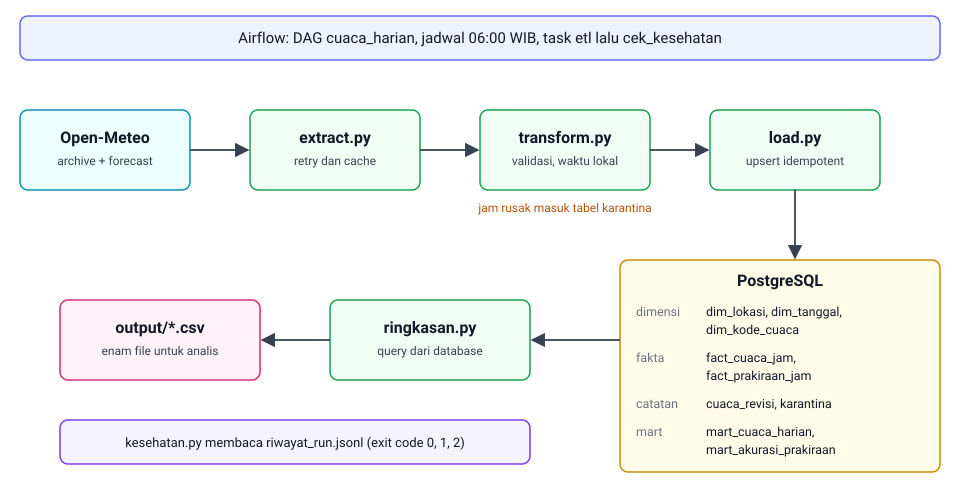

# Cuaca

[](https://github.com/gxjpeg2/cuaca/actions/workflows/ci.yml)

Hourly weather ETL pipeline for 12 Indonesian cities. It pulls actuals and forecasts from Open-Meteo, validates them, quarantines bad rows, and loads a star schema into PostgreSQL. Reruns do not duplicate data, and source revisions are logged. Airflow runs it daily, CI runs lint, type checks, and tests against a real PostgreSQL. Docs are in Indonesian.

Pipeline ETL untuk data cuaca per jam di 12 kota Indonesia. Mengambil data dari [Open-Meteo](https://open-meteo.com), memvalidasinya, menyimpannya ke PostgreSQL sebagai tabel fakta dan dimensi, dan menulis enam CSV. Bisa dijadwalkan harian lewat Airflow.



## Data

| Jenis | Endpoint | Catatan |
|---|---|---|
| Aktual | archive | Reanalisis berbasis model, bukan pengukuran stasiun. Tertinggal beberapa hari dan bisa direvisi. |
| Prakiraan | forecast | Tiap run disimpan sebagai potret terpisah, tidak menimpa run lama. |

Satu run penuh memakai 24 permintaan (2 per kota) dengan jeda 1 detik. Data berlisensi CC BY 4.0, cantumkan Open-Meteo sebagai sumber. API gratisnya untuk penggunaan non-komersial.

## Alur

1. **Extract** (`extract.py`): ambil data aktual per potongan 90 hari dan prakiraan. Coba ulang saat 429, 5xx, atau timeout.
2. **Transform** (`transform.py`): satu baris per kota per jam, waktu lokal, validasi. Jam rusak masuk karantina. Pipeline berhenti kalau lebih dari 50% jam ditolak.
3. **Load** (`load.py`): upsert ke PostgreSQL. Run ulang tidak menggandakan data. Angka yang direvisi sumber dicatat di `cuaca_revisi`.
4. **Output** (`ringkasan.py`): tulis CSV dari database.

## Mulai

Butuh Python 3.10+ dan Docker.

```bash
python -m venv .venv
source .venv/bin/activate          # Windows: .venv\Scripts\Activate.ps1
pip install -r requirements.txt
cp .env.example .env               # Windows: copy .env.example .env
```

Lalu buka `.env` dan isi dua nilai:

- `PGPASSWORD`: password pilihan kamu.
- `AIRFLOW_JWT_SECRET`: hasil `openssl rand -hex 32` (tanpa openssl: `python -c "import secrets; print(secrets.token_hex(32))"`). Wajib terisi, kalau kosong Docker Compose menolak jalan.

```bash
docker compose up -d db

python -m unittest discover -s tests -v
python -m cuaca --hari 2 --lokasi Bandung    # satu kota, dua hari
python -m cuaca                              # 12 kota, 7 hari aktual, 3 hari prakiraan
python -m cuaca.kesehatan
```

Berhasil kalau tes hijau tanpa skip, `output/` berisi enam CSV, dan `logs/riwayat_run.jsonl` bertambah satu baris.

Tanpa internet, pakai sumber simulasi:

```bash
python -m simulasi --interval 10
python -m cuaca --url-simulasi http://127.0.0.1:8000 --jeda-permintaan 0
```

## Contoh hasil

Folder [examples/](examples/) berisi keluaran dari run dengan sumber simulasi (angkanya karangan): enam CSV, cuplikan `mart_cuaca_harian`, dan keluaran `cuaca.kesehatan`.

## Model data

Dimensi (`dim_lokasi`, `dim_tanggal`, `dim_kode_cuaca`) menjawab di mana, kapan, dan jenis apa. Fakta (`fact_cuaca_jam`, `fact_prakiraan_jam`) menjawab berapa. Dua view siap pakai: `mart_cuaca_harian` dan `mart_akurasi_prakiraan`.

Tiga hal yang perlu diketahui sebelum menulis query:

- `waktu_utc` selalu UTC. Kelompokkan per hari dengan `tanggal_lokal`.
- Hanya `curah_hujan_mm` yang boleh di-`SUM`. Suhu, kelembapan, angin, dan tekanan pakai `AVG`, `MIN`, atau `MAX`.
- Filter `WHERE hari_lengkap` di `mart_cuaca_harian` untuk rata-rata dan total.

Contoh, lima kota dengan hujan terbanyak dalam 30 hari:

```sql
SELECT lokasi, ROUND(SUM(curah_hujan_total_mm), 1) AS hujan_mm
FROM mart_cuaca_harian
WHERE hari_lengkap
  AND tanggal > (SELECT MAX(tanggal_lokal) FROM fact_cuaca_jam) - 30
GROUP BY lokasi
ORDER BY hujan_mm DESC
LIMIT 5;
```

Penjelasan tiap kolom ada di [docs/kamus_data.md](docs/kamus_data.md).

## Dokumentasi

- [docs/panduan.md](docs/panduan.md): backfill, Docker, Airflow, simulasi, opsi CLI, cek kesehatan, pengembangan, keamanan, catatan teknis.
- [examples/](examples/): contoh keluaran.
- [docs/kamus_data.md](docs/kamus_data.md): kolom, tipe, dan satuan.

## Lisensi

Kode: MIT, lihat [LICENSE](LICENSE). Data: CC BY 4.0 dari Open-Meteo.
